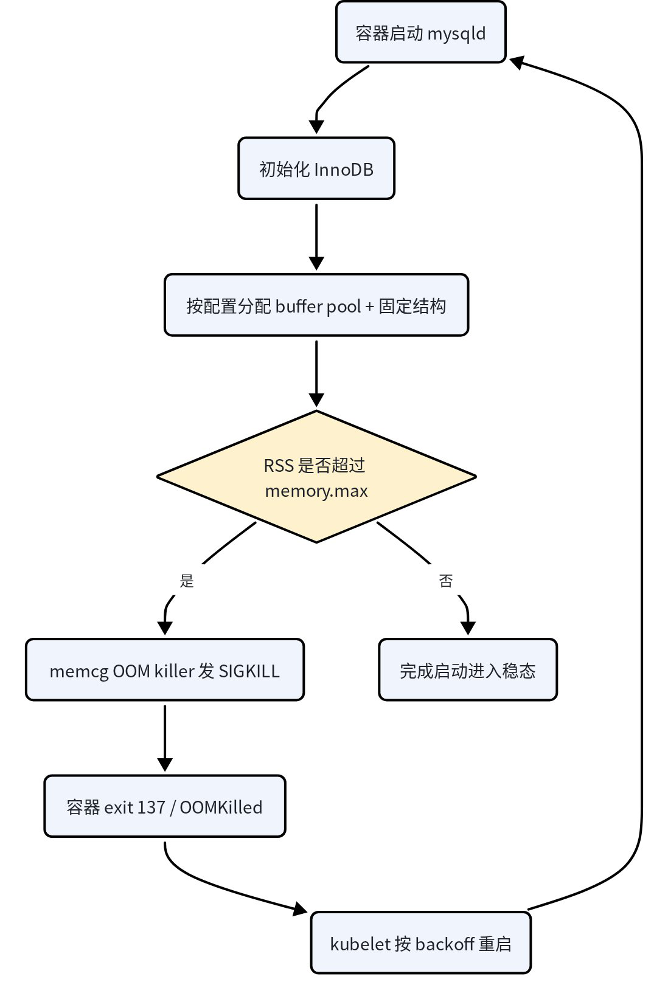

# 内核 OOM Killer 导致 MySQL 实例起不来：原理与排查

::: warning 一句话结论
容器内存上限（cgroup `memory.max`）被 mysqld **启动瞬间的内存峰值**打穿，内核 memcg OOM killer 直接发 `SIGKILL`（Pod 表现为 `OOMKilled` / exit 137）。由于是不干净退出，下次启动必须先做崩溃恢复，而恢复阶段的内存需求反而更高——于是在同一上限下再次被杀，最终进入 `CrashLoopBackOff`，看起来就是"怎么都拉不起来"。
:::

## 一、现象与判定

### 典型表现

- Pod 反复重启，`RESTARTS` 持续增长，最终进入 `CrashLoopBackOff`；
- 容器 last state 为 `Terminated`，`Reason: OOMKilled`，`Exit Code: 137`；
- 节点内核日志出现 `Memory cgroup out of memory: Killed process ... (mysqld)`；
- 业务侧看不到 MySQL 报错，只看到实例初始化失败、连接不上。

> 在基于 KubeBlocks 的 operator 里，初始化容器往往只报 `... failed` 且 `output:` 为空，真实原因需要去 `<datadir>/log_error.err` 和 Pod 终态里找。

### 快速确认

```bash
# 1. 看容器终态：Reason 必须是 OOMKilled
kubectl -n <namespace> describe pod <pod-name> | grep -A6 'Last State'
```

期望输出形如：

```text
Last State:     Terminated
  Reason:       OOMKilled
  Exit Code:    137
```

```bash
# 2. 节点内核日志：确认是 cgroup 级还是节点级
dmesg -T | grep -iE 'oom|killed process'
```

```text
# 容器级（最常见）
Memory cgroup out of memory: Killed process 12345 (mysqld) total-vm:...
# 节点级（无 limit 或节点整体内存耗尽）
Out of memory: Killed process 12345 (mysqld) total-vm:...
```

```bash
# 3. cgroup v2 计数器（注意：容器重启后 cgroup 可能被重建，计数会归零）
cat /sys/fs/cgroup/<path>/memory.max
cat /sys/fs/cgroup/<path>/memory.current
cat /sys/fs/cgroup/<path>/memory.events
```

`memory.events` 中 `oom` / `oom_kill` 非零即为证据。

> **重要区分**：`Exit Code: 137` 只能说明进程收到 `SIGKILL`，不等于 OOM。liveness probe 超时被 kubelet 杀掉同样也是 137。必须看 `Reason` 是否为 `OOMKilled`，并配合 dmesg 交叉验证。

## 二、原理：为什么偏偏死在启动阶段

关键认知：**MySQL 的启动阶段是整个生命周期里内存占用最高的时刻，而不是稳态。**

### 启动时一次性占用的内存

| 内存项 | 说明 |
| --- | --- |
| `innodb_buffer_pool_size` | 初始化阶段就按配置真实分配并初始化，不是"用多少涨多少"的缓存。配 16G，启动就要 16G |
| `performance_schema` | 8.0 默认开启，几百 MB 量级，随 instrument / consumer 数量变化 |
| redo log buffer | `innodb_log_buffer_size`，启动即分配 |
| 自适应哈希索引 / 字典缓存 / 锁结构 | 随 buffer pool 规模放大的固定结构 |
| temp table | 8.0 的 temptable 引擎，初始化与 DDL 阶段可能出现峰值 |
| 线程栈与连接缓冲 | `thread_stack` × 连接数，加上 net buffer |

所以很容易出现一种错配：**内存 limit 刚好覆盖"跑起来之后"的 RSS，却覆盖不了"启动瞬间"的峰值**。于是每次启动都在同一个位置触线被杀。

### 为什么启动阶段特别脆弱



*图：启动峰值打穿上限 → SIGKILL → 不干净退出 → 下次启动要做崩溃恢复 → 恢复阶段内存更高 → 再次被杀*

## 三、为什么一次 OOM 会变成"永久起不来"

这是整条链路最关键的放大机制：

1. **OOM 用的是 `SIGKILL`**，MySQL 没有机会执行干净 shutdown，redo log 停留在"需要崩溃恢复"的状态；
2. 下次启动必须先做 **crash recovery**：从最后一个 checkpoint 扫描 redo、回滚未提交事务。这个阶段需要额外的内存和更长的执行时间；
3. 在同样的内存 limit 下，**恢复阶段比正常启动更容易再次触顶**；
4. 一旦在恢复过程中被杀，checkpoint 没有推进，下一轮又从同一位置重新恢复。

结果就是：每轮都在恢复阶段被杀，恢复永远跑不完，表现为"进程怎么都拉不起来"。此外 kubelet 的重启 backoff 会从 10 秒逐步翻倍到 5 分钟，观察上会越来越像"彻底起不来"。

::: info 补充
如果 OOM 发生在正常运行期，除了崩溃恢复压力，还可能叠加数据量增长、buffer pool 被调大、同节点其他进程抢占内存等因素，使下一次启动的内存需求比上一次更高。
:::

## 四、处置建议

### 1. 先抬 limit，让实例起来

在 crash recovery 循环中，**反复重启只会让每轮恢复从头再来**。正确做法是：

- 把容器内存 limit 临时抬到足以覆盖"启动峰值 + 恢复开销"，让恢复完整跑完；
- 确认实例稳定后，再根据实际 RSS 决定是否回调和如何优化配置。

### 2. 按启动峰值而不是稳态配 buffer pool

- `innodb_buffer_pool_size` 建议控制在容器 limit 的 **60%–70%**，比贴着上限更安全；
- 配置模板里通常会对 `innodb_buffer_pool_size` 设一个"不超过容器内存上限 80%"的硬上限。注意这个 80% 是**防 OOM 的上限**，不是"留够了启动峰值余量"的保证——剩下 20% 还要容纳 performance_schema、连接和恢复过程；
- 小规格实例、`performance_schema` 全开、连接数较高的场景，应进一步下调比例。

### 3. 削减启动期固定开销

- 关闭或裁剪 `performance_schema`（`performance_schema=OFF`，或减少 instruments / consumers）；
- 降低 `max_connections`、`thread_stack`、`temptable_max_ram` 等与连接和临时表相关的配置；
- 避免在启动脚本中并行执行吃内存的工具（备份、大批量导入等）。

### 4. 排除非 cgroup 因素

| 检查项 | 说明 |
| --- | --- |
| `ulimit -v` / `RLIMIT_AS` | 虚拟内存上限可能导致大块 mmap 失败 |
| `vm.overcommit_memory` | 为 2 且 overcommit ratio 偏小时，即使 `free` 有余量也会分配失败 |
| 节点整体内存 | 所有 Pod 的 request / limit 之和是否超过节点可分配内存，是否存在节点级 OOM |
| kubelet 驱逐阈值 | `memory.available` 触发驱逐时，实例会被迁移或重启 |

::: warning 不要把 `innodb_force_recovery` 当常规恢复手段
它只适合紧急导出数据，长期开启会掩盖数据损坏问题。内存不足导致的恢复循环，正解是给足内存让恢复自然完成。
:::

## 五、不要与这些"起不来"混淆

| 现象 | 根因 | 是否本条 |
| --- | --- | --- |
| `OOMKilled` / exit 137 + dmesg OOM 记录 | cgroup / 节点内存触顶 | ✅ 是 |
| 错误日志 `Cannot allocate memory`、`InnoDB: Cannot allocate memory for the buffer pool` | malloc / mmap 失败（limit 过低、overcommit、RLIMIT_AS），进程自己退出 | ❌ 否 |
| `io_setup() failed with EAGAIN` / `Cannot initialize AIO sub-system` | 节点 `fs.aio-max-nr` 配额耗尽，与内存无关，见[另一个案例](./aio-max-nr.md) | ❌ 否 |
| Pod 长期 `Pending`、事件 `didn't have free ports` | hostPort 冲突或调度问题 | ❌ 否 |

## 六、结论

内核 OOM killer 导致 MySQL 起不来的本质是一个闭环：**启动峰值打穿上限 → `SIGKILL` → 不干净退出 → 崩溃恢复需要更多内存 → 再次被杀**。

排查时先确认 `OOMKilled` 与 dmesg 证据；处置时优先抬高内存 limit 让恢复完整跑完，再按启动峰值重新规划 buffer pool 与固定开销。
