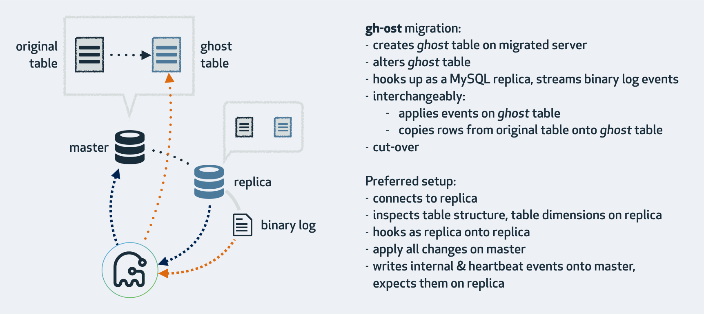
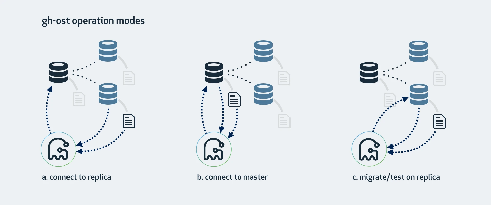

# gh-ost 原理及源码解析

::: info 写在前面
本文是 gh-ost 的原理介绍与关键步骤的源码解析，**重点在新旧表切换（cut-over）的算法**，见 2.4 节。文末附常见问题与改进方向。

代码片段取自 gh-ost 源码；图 1、图 2 来自 gh-ost 官方文档。
:::

## 1. 异步改表原理

### 1.1 改表流程

gh-ost 是 GitHub 针对 pt-osc 用触发器带来的问题而重新设计的表结构变更工具，它用 **binlog + 回放线程**替代了触发器。

它要解决的关键问题是：添加／修改／删除列和索引在 MySQL 上默认是阻塞操作，而业务侧这类变更是频繁的，需要尽量减小对用户的影响。



以最常见的模式说明 gh-ost 的改表流程：

1. **连接到主库**：
   - 创建临时的 `_gho` 表；
   - 根据 `alter` 语句修改这张新表。

2. **作为一个"备库"连接到主库**（或某个从库）：
   - 一边把已有的数据从原表拷贝到新表；
   - 一边从主库（或某个从库）拉取增量数据的 binlog；
   - 把 binlog 事件应用到 `_gho` 表上。

3. **cut-over**：
   - 锁住原表，交换 `_gho` 表和原表。

### 1.2 三种执行模式

gh-ost 既可以在主库上执行，也可以在从库上执行，甚至只在从库上修改和测试。

#### 1.2.1 连上从库，在主库上修改

这是 gh-ost 的默认模式：它查看从库情况，找到集群主库并连接上去。

- 在主库上读写行数据；
- 在从库上读取 binlog 事件，把变更应用到主库；
- 在从库上查看表格式、字段、主键、总行数等；
- 在从库上读取 gh-ost 内部事件日志（比如心跳）；
- 在主库上完成表切换。

如果主库的 binlog 格式是 Statement，就可以用这种模式。但从库必须启用 binlog（`log_bin`、`log_slave_updates`）且设为 Row 格式（`binlog_format=ROW`）——实际上 gh-ost 会帮你在从库上设置这些。

#### 1.2.2 连上主库

没有从库、或者不想在从库上操作时，可以直接在主库上完成所有操作，这仍然可以查看主从复制延迟。

- 主库必须产生 Row 格式的 binlog；
- 启动时用 `--allow-on-master` 开启这种模式。

#### 1.2.3 在从库上修改和测试

这种模式在从库上做修改。gh-ost 仍会连上主库，但所有操作都在从库上完成，不影响主库；过程中会不时暂停，让从库数据保持最新。

- `--migrate-on-replica`：直接在从库上修改表，最终切换也在从库正常复制的状态下完成。
- `--test-on-replica`：仅用于测试。在最终切换前停止复制，把原表和临时表互换再换回来，最终相当于原表没被动过。复制暂停的状态下可以检查、对比两张表的数据。



### 1.3 一次改表的完整调用参数

```bash
gh-ost \
--max-load=Threads_running=100 \
--critical-load=Threads_running=200 \
--chunk-size=5000 \
--throttle-control-replicas="replica1.example.com,replica2.example.com" \
--max-lag-millis=3000 \
--user="ghost_user" \
--password="******" \
--host=replica.example.com \
--database="my_schema" \
--table="my_table" \
--verbose \
--alter="engine=innodb" \
--switch-to-rbr \
--allow-on-master \
--cut-over=default \
--initially-drop-ghost-table \
--ok-to-drop-table \
--approve-renamed-columns \
--default-retries=120 \
--panic-flag-file=/tmp/ghost.panic.flag \
--execute
```

gh-ost 账号需要的权限：

```sql
-- 在被修改的库表上：
ALTER, CREATE, DELETE, DROP, INDEX, INSERT, LOCK TABLES, SELECT, TRIGGER, UPDATE

-- 另外还需要（二选一）：
SUPER, REPLICATION SLAVE ON *.*
-- 或者
REPLICATION CLIENT, REPLICATION SLAVE ON *.*
```

其中 `SUPER` 用于 `STOP SLAVE`、`START SLAVE` 操作。

## 2. 源码解析

在进入主流程之前，先说明改表过程中的几个重要组件：

```text
inspector      ：检查表行数、表结构是否合规、监控心跳等。一般在从库上进行，
                 配置 --allow-on-master 后可在主库上执行
applier        ：连接主库，执行表变更、复制行、应用 binlog
eventsStreamer ：读取 binary log，一般在 gh-ost 执行机本机
throttler      ：控制程序暂停
```

gh-ost 把改表的核心功能分类到这些组件中，实现对各种改表流程的控制。

### 2.1 创建影子表，并在影子表上做修改

```go
func (this *Migrator) initiateApplier() error {
    this.applier = NewApplier(this.migrationContext)
    if err := this.applier.InitDBConnections(); err != nil {
       return err
    }
    if err := this.applier.ValidateOrDropExistingTables(); err != nil {
       return err
    }
    if err := this.applier.CreateChangelogTable(); err != nil {
       this.migrationContext.Log.Errorf("Unable to create changelog table...")
       return err
    }
    if err := this.applier.CreateGhostTable(); err != nil {
       this.migrationContext.Log.Errorf("Unable to create ghost table...")
       return err
    }
    if err := this.applier.AlterGhost(); err != nil {
       this.migrationContext.Log.Errorf("Unable to ALTER ghost table...")
       return err
    }

    if this.migrationContext.OriginalTableAutoIncrement > 0 && !this.parser.IsAutoIncrementDefined() {
       // 原表有 AUTO_INCREMENT 且 alter 语句未显式覆盖时，
       // 需要把 AUTO_INCREMENT 值复制到影子表上
       if err := this.applier.AlterGhostAutoIncrement(); err != nil {
          return err
       }
    }
    this.applier.WriteChangelogState(string(GhostTableMigrated))
    go this.applier.InitiateHeartbeat()
    return nil
}
```

- `CreateGhostTable()` 复制原表的表结构：

```sql
create /* gh-ost */ table db.t_gho like db.t
```

- `AlterGhost()` 在 `_gho` 表上修改表结构：

```sql
alter /* gh-ost */ table db.t_gho %s
```

### 2.2 row-copy：行复制

行复制开始前，gh-ost 会先检查原表**是否有主键**，并找出原表和影子表**共有**的 unique key，用共有的唯一键来定位每一行数据。

```go
func BuildRangeInsertQuery(databaseName, originalTableName, ghostTableName string,
    sharedColumns []string, mappedSharedColumns []string, uniqueKey string,
    uniqueKeyColumns *ColumnList, rangeStartValues, rangeEndValues []string,
    rangeStartArgs, rangeEndArgs []interface{}, includeRangeStartValues bool,
    transactionalTable bool, noWait bool) (result string, explodedArgs []interface{}, err error) {

    if len(sharedColumns) == 0 {
       return "", explodedArgs, fmt.Errorf("Got 0 shared columns in BuildRangeInsertQuery")
    }
    sharedColumnsListing := strings.Join(sharedColumns, ", ")

    rangeEndComparison, rangeExplodedArgs, err := BuildRangeComparison(
        uniqueKeyColumns.Names(), rangeEndValues, rangeEndArgs, LessThanOrEqualsComparisonSign)
    if err != nil {
       return "", explodedArgs, err
    }
    explodedArgs = append(explodedArgs, rangeExplodedArgs...)
    result = fmt.Sprintf(`
       insert /* gh-ost %s.%s */ ignore
       into
          %s.%s
          (%s)
       (
          select %s
          from
             %s.%s
          force index (%s)
          where
             (%s and %s)
             %s
       )`,
       databaseName, originalTableName, databaseName, ghostTableName, mappedSharedColumnsListing,
       sharedColumnsListing, databaseName, originalTableName, uniqueKey,
       rangeStartComparison, rangeEndComparison, transactionalClause)
    return result, explodedArgs, nil
}
```

- 插入语句的内容由 `chunk-size`（一次插入影子表的行数）和共有的唯一键确定。
- **注意这里用的是 `insert ... ignore` 而不是 `insert`。** 原因是 gh-ost 处理过程中，**应用 binlog 事件比 row-copy 有更高的优先级**，插入语句执行之前影子表可能已经通过 binlog 事件写入了某一行——这一点在 2.3 节详细说明。

```sql
insert /* gh-ost %s.%s */ ignore into db.t_gho (col1,col2,col3)
(
    select col1,col2,col3
    from
       db.t
    force index (`PRIMARY`)
    where
        (((`id` > ?) or ((`id` = ?))) and ((`id` < ?) or ((`id` = ?))))
                                lock in share mode
)
```

### 2.3 应用 binlog

先在原表上监听 binlog 事件，写入待处理队列：

```go
func (this *Migrator) addDMLEventsListener() error {
    err := this.eventsStreamer.AddListener(
       false,
       this.migrationContext.DatabaseName,
       this.migrationContext.OriginalTableName,
       func(dmlEvent *binlog.BinlogDMLEvent) error {
          this.applyEventsQueue <- newApplyEventStructByDML(dmlEvent)
          return nil
       },
    )
    return err
}
```

再从处理队列中取出每一个事件，应用到影子表 `_gho` 上：

```go
func (this *Migrator) executeWriteFuncs() error {
    if this.migrationContext.Noop {
       return nil
    }
    for {
       if atomic.LoadInt64(&this.finishedMigrating) > 0 {
          return nil
       }

       this.throttler.throttle(nil)

       // 事件处理优先，row-copy 次之
       select {
       case eventStruct := <-this.applyEventsQueue:
          {
             if err := this.onApplyEventStruct(eventStruct); err != nil {
                return err
             }
          }
       default:
          {
             select {
             case copyRowsFunc := <-this.copyRowsQueue:
                {
                   copyRowsStartTime := time.Now()
                   if err := copyRowsFunc(); err != nil {
                      return this.migrationContext.Log.Errore(err)
                   }
                   if niceRatio := this.migrationContext.GetNiceRatio(); niceRatio > 0 {
                      copyRowsDuration := time.Since(copyRowsStartTime)
                      sleepTimeNanosecondFloat64 := niceRatio * float64(copyRowsDuration.Nanoseconds())
                      sleepTime := time.Duration(int64(sleepTimeNanosecondFloat64)) * time.Nanosecond
                      time.Sleep(sleepTime)
                   }
                }
             default:
                {
                   // 队列里既没有事件也没有行拷贝，可能在负载下，睡一会
                   time.Sleep(time.Second)
                }
             }
          }
       }
    }
}
```

**binlog 事件优先级高于行复制。** 这可能与直觉相反，但通过语句改写，无论 row-copy 先处理还是 binlog 事件先处理，都能保证最终数据一致。

binlog 解析与回放：gh-ost 先解析 binlog 事件生成 SQL 语句，方式和行复制生成 insert 语句一样——通过预定义模板和共有唯一键生成对应语句：

```go
func NewDMLInsertQueryBuilder(databaseName, tableName string, tableColumns,
    sharedColumns, mappedSharedColumns *ColumnList) (*DMLInsertQueryBuilder, error) {
    if !sharedColumns.IsSubsetOf(tableColumns) {
       return nil, fmt.Errorf("shared columns is not a subset of table columns")
    }
    if sharedColumns.Len() == 0 {
       return nil, fmt.Errorf("no shared columns found")
    }
    databaseName = EscapeName(databaseName)
    tableName = EscapeName(tableName)
    mappedSharedColumnNames := duplicateNames(mappedSharedColumns.Names())
    for i := range mappedSharedColumnNames {
       mappedSharedColumnNames[i] = EscapeName(mappedSharedColumnNames[i])
    }
    preparedValues := buildColumnsPreparedValues(mappedSharedColumns)

    stmt := fmt.Sprintf(`
       replace /* gh-ost %s.%s */
       into
          %s.%s
          (%s)
       values
          (%s)`,
       databaseName, tableName,
       databaseName, tableName,
       strings.Join(mappedSharedColumnNames, ", "),
       strings.Join(preparedValues, ", "),
    )
    return &DMLInsertQueryBuilder{
       tableColumns:      tableColumns,
       sharedColumns:     sharedColumns,
       preparedStatement: stmt,
    }, nil
}
```

但对不同类型的语句会做改写：

- `delete` → 仍为 `delete`
- `insert` → 改写为 `replace into`
- `update` → 仍为 `update`

这样做是为了保证**无论 row-copy 先发生还是 binlog 事件先发生，都不会影响数据正确性**。

gh-ost 做 DDL 期间，对原表和影子表的操作有三种：把原表数据拷贝到影子表、业务对原表的 DML（产生 binlog）、把原表的 binlog 应用到影子表。由于 binlog 由 DML 产生，应用 binlog 一定在对应 DML 之后，所以只存在以下三种顺序。

**顺序一：`copy → dml → apply binlog`**

| 数据拷贝 | DML | 应用 binlog |
| --- | --- | --- |
| `insert ignore into b select id>0 and id<3;` | `insert into b values(2,'b');` | `replace into b values(2,'b');` |
| `insert ignore into b select id>0 and id<3;` | `update b set val='b' where id=1;` | `update b set val='b' where id=1;` |
| `insert ignore into b select id>0 and id<3;` | `delete from b where id=1;` | `delete from b where id=1;` |

这种顺序下影子表的数据修改顺序与主库完全一致，天然一致。

**顺序二：`dml → copy → apply binlog`**

| DML | 数据拷贝 | 应用 binlog |
| --- | --- | --- |
| `insert into b values(2,'b');` | 拷贝把 `(2,'b')` 插入影子表 | `replace` 覆盖数据，结果一致 |
| `update b set val='b' where id=1;` | 拷贝把 `(1,'b')` 插入影子表 | 执行同样的 `update`，结果一致 |
| `delete from b where id=1;` | 拷贝时该行已被删除，不会拷贝 | `delete` 时影子表无该记录，删除空记录 |

**顺序三：`dml → apply binlog → copy`**

| DML | 应用 binlog | 数据拷贝 |
| --- | --- | --- |
| `insert into b values(2,'b');` | `replace` 写入影子表 | 拷贝语句是 `insert ignore`，忽略插入 |
| `update b set val='b' where id=1;` | `update` 时影子表无该记录，更新空记录 | 拷贝的是 update 之后的数据 |
| `delete from b where id=1;` | `delete` 时影子表无该记录，删除空记录 | 拷贝时该行已删除，不会拷贝 |

三种顺序都能保证拷贝过程中影子表与原表一致。**这就是 `insert ... ignore` 和 `insert → replace into` 这两个改写的意义**：它们让两种操作的先后顺序变得无关紧要。

### 2.4 cut-over

#### 2.4.1 为什么不能直接 RENAME

最直观的方案是：

```sql
RENAME TABLE tbl TO tbl_old, tbl_new TO tbl;
```

这是一条原子的表交换语句。但复制是**异步**的，必须先锁住原表禁止写入，再执行交换。问题在于：**表被锁住时无法执行 `RENAME`。**

```sql
> LOCK TABLES tbl WRITE;
Query OK, 0 rows affected (0.00 sec)

> RENAME TABLE tbl TO tbl_old, tbl_new TO tbl;
ERROR 1192 (HY000): Can't execute the given command because you have active locked tables or an active transaction

> ALTER TABLE tbl RENAME TO tbl_old; ALTER TABLE tbl_new RENAME TO tbl;
Query OK, 0 rows affected (0.00 sec)
```

为什么 `ALTER` 可以而 `RENAME` 不行？

> 因为 `ALTER TABLE` 会触发 InnoDB 的隐式提交，锁在第一条 `ALTER` 之后被释放。因此在两次 `ALTER` 之间执行的事务会收到"表不存在"错误；但第二条 `ALTER` 预期非常快——影子表对其他事务不可见，无需等待。

所以这个方案会在很短时间内导致**表不存在**的报错。

#### 2.4.2 原子表交换的 8 个阶段

另一种方案可以在安全的前提下原子地完成表交换。为便于描述，先约定符号：

| 符号 | 含义 |
| --- | --- |
| C1 ... C9 | 锁表之前存在的不同客户端 DML 连接 |
| C10 | 执行锁表的系统连接 |
| C11 ... C19 | 锁表之后到达的 DML 连接 |
| C20 | 执行 rename 的系统连接 |
| C21 ... C29 | rename 之后到达的 DML 连接 |

整个 rename 过程分为 8 个阶段：

```text
阶段 1 → 初始状态，cut-over 之前
├── C1-C9: Running (DML)
├── 其他连接: 未连接

阶段 2 → 创建魔法表
├── C10: CREATE TABLE tbl_old (id int primary key) COMMENT='magic-be-here'

阶段 3 → 创建表锁
├── C10: Locked (tbl WRITE, tbl_old WRITE)

阶段 4 → RENAME 进入执行队列
├── C11-C19: Blocked (等待 C10 的锁)
├── C20: RENAME TABLE tbl TO tbl_old, ghost TO tbl  Blocked (等待锁)，优先级最高

阶段 5 → 新的客户端连接进入等待队列
├── C21-C29: Blocked (等待 C10 的锁和 C20 的 RENAME)
├── C10: Locked
├── C20: Blocked (等待锁)

阶段 6 → 删除魔法表
├── C10: Running (检查 processlist，确认 RENAME 仍在等待队列)
├── C10: DROP TABLE tbl_old   （表交换仍未发生，因为表锁未释放）

阶段 7 → 释放表锁，执行 cut-over
├── C10: Unlocked
├── C20: Running (RENAME 成功)
├── C11-C19 / C21-C29: Blocked (等待 C20 完成 RENAME)

阶段 8 → DML 语句按顺序执行
├── C20: Completed
├── C1-C9 / C11-C19 / C21-C29: Running (DML 继续)
```

⚠️ 几个关键点：

- **创建 `tbl_old` 是为了防止表被过早交换**——`RENAME` 要求目标名不存在。
- **一个会话在持有 `WRITE LOCK` 后仍可以执行 `DROP TABLE`**，这是阶段 6 能成立的前提。
- **被阻塞的 `RENAME` 优先级永远高于被阻塞的 `INSERT/UPDATE/DELETE`**，无论谁先进入队列。这保证了交换不会被后面的 DML 抢先。
- 阶段 3 的 `LOCK TABLES tbl WRITE, tbl_old WRITE` 会获取**元数据锁**，一旦执行，即使在等待锁时也会阻塞后续会话的 DML，等待超时取决于 MySQL 参数 `lock_wait_timeout`。gh-ost 的取锁流程是：
  - 先设置会话级参数 `set session lock_wait_timeout = 6`（该值为 `--cut-over-lock-timeout-seconds * 2`，默认 3，即设置成 6 秒）；
  - 如果表上有大事务，可能获取元数据锁超时，gh-ost 会重试至多 `--default-retries` 次（默认 60）；
  - 重试达到上限仍未取到元数据锁，则程序失败退出。

#### 2.4.3 cut-over 失败时会怎样

| 失败位置 | 后果 |
| --- | --- |
| C10 在 `CREATE` 时失败 | 只是创建了一个用户不可见的魔法表，什么都没发生 |
| C10 在 `LOCK` 时失败 | 表不会被锁，业务正常执行其他语句 |
| C10 在 C20 即将 `RENAME` 时失败 | 释放锁，C1–C9、C11–C19 立即在原表上执行；C20 的 `RENAME` 立即失败（因为 `tbl_old` 存在）。影响仅为这些连接被锁了一小段时间 |
| C10 在 C20 的 `RENAME` 被阻塞后失败 | 同上：释放锁，`RENAME` 因 `tbl_old` 存在而立即失败 |
| C20 在 C10 删除魔法表之前失败 | 程序捕获失败，由 C10 执行 `DROP`、`UNLOCK` |
| C20 在 C10 删表之后、unlock 之前失败 | 同上一行 |
| C10 与 C20 都失败 | 也没有问题：`LOCK`、`RENAME` 都被释放，所有连接可正常操作原表 |

**无论 cut-over 时发生什么异常，整个过程都是原子的，不会导致数据丢失。** 这是理解 gh-ost 安全性最重要的一点：它不依赖"不出错"，而是让任意错误都落在可恢复的中间态上。

## 3. 流程控制的关键问题

### 3.1 如何控制异常终止

```go
// 迁移开始时监听终止通道
func (this *Migrator) listenOnPanicAbort() {
    err := <-this.migrationContext.PanicAbort
    this.migrationContext.Log.Fatale(err)
}

// 记录 FATAL 日志并退出
func Fatale(err error) error {
    logErrorEntry(FATAL, err)
    os.Exit(1)
    return err
}
```

什么情况会终止 gh-ost 线程：

- 手动写入终止标记位：`--panic-flag-file=/tmp/ghost.panic.flag`；
- 达到中断的负载阈值：`--critical-load=Threads_running=1000`。

### 3.2 如何暂停改表进程

每次写入影子表之前都会检查是否应该阻塞执行：

```go
for {
    if atomic.LoadInt64(&this.finishedMigrating) > 0 {
       return nil
    }
    this.throttler.throttle(nil)
    select {
    case eventStruct := <-this.applyEventsQueue:
       ...
    }
}
```

gh-ost 会暂停的情况：

- 手动设置暂停标志：`--throttle-flag-file`；
- 达到设置的最大负载：`--max-load=Threads_running`；
- 主从延时达到设定阈值：`--max-lag-millis`；
- 网络抖动（向指定服务器发空 HTTP 请求失败）：`--throttle-http`；
- 从从库读取心跳信号失败；
- 设定的暂停查询返回正常：`--throttle-query`。

### 3.3 如何检查表行数

`count(*)` 可能造成慢查询、加重服务器负载，所以默认用 `EXPLAIN`：

```sql
explain /* gh-ost */ select * from db.table where 1=1
```

如果设置了 `--exact-rowcount`，则改用 `count(*)` 计算实际行数。

### 3.4 如何探测心跳

```go
func (this *Applier) InitiateHeartbeat() {
    var numSuccessiveFailures int64
    injectHeartbeat := func() error {
       if atomic.LoadInt64(&this.migrationContext.HibernateUntil) > 0 {
          return nil
       }
       if _, err := this.WriteChangelog("heartbeat", time.Now().Format(time.RFC3339Nano)); err != nil {
          numSuccessiveFailures++
          if numSuccessiveFailures > this.migrationContext.MaxRetries() {
             return this.migrationContext.Log.Errore(err)
          }
       } else {
          numSuccessiveFailures = 0
       }
       return nil
    }
    injectHeartbeat()

    ticker := time.NewTicker(time.Duration(this.migrationContext.HeartbeatIntervalMilliseconds) * time.Millisecond)
    defer ticker.Stop()
    for range ticker.C {
       if atomic.LoadInt64(&this.finishedMigrating) > 0 {
          return
       }
       if throttle, _, reasonHint := this.migrationContext.IsThrottled(); throttle && (reasonHint == base.UserCommandThrottleReasonHint) {
          continue
       }
       if err := injectHeartbeat(); err != nil {
          return
       }
    }
}
```

心跳写在 `_ghc`（changelog）表里，长这样：

| id | last_update | hint | value |
| --- | --- | --- | --- |
| 1 | 2024-12-04 12:12:37 | heartbeat | 2024-12-04T12:12:37.402616178+08:00 |
| 2 | 2024-12-04 11:49:01 | state | GhostTableMigrated |
| 3 | 2024-12-04 12:10:22 | throttle | done throttling |
| 256 | 2024-12-04 11:49:01 | state at 1733284141844761027 | GhostTableMigrated |

**心跳是"主库还在正常写入"的证明。** 因为主库上的写入会通过复制流到从库，如果从库能读到最新的心跳记录，就说明复制链路是通的、延时可接受。

### 3.5 如何控制主从延时

主从延时检测基于心跳，通过 `--throttle-control-replicas` 指定需要检测的从库：

```sql
select value from db._ghc where hint = 'heartbeat' and id <= 255
```

在所有被检测的从库上查询最近一次心跳写入时间，取其中的最大值作为判定依据。

检测频率采用**动态策略**：

```go
relaxedFactor := 10
counter := 0
shouldReadLagAggressively := false

ticker := time.NewTicker(100 * time.Millisecond)
defer ticker.Stop()
for range ticker.C {
    if atomic.LoadInt64(&this.finishedMigrating) > 0 {
       return
    }
    if counter%relaxedFactor == 0 {
       // 每秒才判断一次是否需要激进检测；
       // 该条件在一次迁移中通常不会变化
       counter = 0
       maxLagMillisecondsThrottleThreshold := atomic.LoadInt64(&this.migrationContext.MaxLagMillisecondsThrottleThreshold)
       shouldReadLagAggressively = (maxLagMillisecondsThrottleThreshold < 1000)
    }
    if counter == 0 || shouldReadLagAggressively {
       checkControlReplicasLag()
    }
    counter++
}
```

- 定时器每 100 毫秒触发一次；
- 每 10 次（1 秒）检查一次复制延时；但如果设置的最大延时阈值 < 1000ms，就每 100 毫秒检查一次。

**阈值越严格、检测越频繁**——这个设计避免了在宽松阈值下无谓地查询从库。

### 3.6 如何确定迁移的数据范围

从主库查询主键范围的上下界：

```go
func buildUniqueKeyMinMaxValuesPreparedQuery(databaseName, tableName string,
    uniqueKey *UniqueKey, order string) (string, error) {
    if uniqueKey.Columns.Len() == 0 {
       return "", fmt.Errorf("Got 0 columns in BuildUniqueKeyMinMaxValuesPreparedQuery")
    }
    databaseName = EscapeName(databaseName)
    tableName = EscapeName(tableName)

    uniqueKeyColumnNames := duplicateNames(uniqueKey.Columns.Names())
    uniqueKeyColumnOrder := make([]string, len(uniqueKeyColumnNames))
    for i, column := range uniqueKey.Columns.Columns() {
       uniqueKeyColumnNames[i] = EscapeName(uniqueKeyColumnNames[i])
       if column.Type == EnumColumnType {
          uniqueKeyColumnOrder[i] = fmt.Sprintf("concat(%s) %s", uniqueKeyColumnNames[i], order)
       } else {
          uniqueKeyColumnOrder[i] = fmt.Sprintf("%s %s", uniqueKeyColumnNames[i], order)
       }
    }
    query := fmt.Sprintf(`
       select /* gh-ost %s.%s */ %s
       from
          %s.%s
       force index (%s)
       order by
          %s
       limit 1`,
       databaseName, tableName, strings.Join(uniqueKeyColumnNames, ", "),
       databaseName, tableName, uniqueKey.Name,
       strings.Join(uniqueKeyColumnOrder, ", "),
    )
    return query, nil
}
```

通过 `order by desc` / `order by asc` 分别查出当前原表的主键上下界，从而把整个表切成若干 `chunk-size` 大小的区间。

### 3.7 cut-over 的时机

表切换发生在什么时候？

- 首先，在 row-copy 完成之后尝试切换：

```go
this.consumeRowCopyComplete()
this.migrationContext.Log.Infof("Row copy complete")
if err := this.hooksExecutor.onRowCopyComplete(); err != nil {
    return err
}
this.printStatus(ForcePrintStatusRule)

// ...

if err := retrier(this.cutOver); err != nil {
    return err
}
```

- 其次，必须**主从延时小于设定的阈值**，并且小于设定加锁的最大时间。

也就是说，cut-over 不是"拷贝完就立刻切"，而是拷贝完成**且**复制延迟处在安全范围内时才会发起。

## 4. 常见问题

### 4.1 改表成功了，为什么工单显示报错？

改表本身已经成功，但工单状态是失败。最常见的原因出在**删除 `_del` 表**这一步：

`_del` 是交换后被替换下来的原表。删除 `_del` 时会造成系统负载上升、IO 上升，从而引起瞬时 QPS 增加，工单可能因此被标记为报错。

排查思路是看报错出现的**时间点**：如果落在 cut-over 之后的清理阶段，基本可以判定是删除旧表引发的，而不是改表本身失败。

### 4.2 为什么改表之后出现 `_gho`、`_ghc`、`_del` 表？

- **cut-over 之前**：存在 `_gho`（影子表）和 `_ghc`（心跳表）。
  - 若在 cut-over 之前异常退出，临时表不会被删除。
- **cut-over 之后**：存在 `_ghc` 和 `_del`（被替换下来的原表）。
  - 正常执行完成后，清理程序会删除 `_ghc`，并删除交换后的 `_del`；
  - 但如果交换表完成后、清理表之前程序异常退出，就会残留 `_ghc` 和／或 `_del`。

相关参数：

- `--ok-to-drop-table=false`：每次改表完成后不删除 `_del`，可避免大表删除对机器负载造成压力；
- `--initially-drop-old-table=true`：下一次改表开始前检测是否存在 `_del`，有则删除；
- `--initially-drop-ghost-table`：下一次改表开始前检测是否存在 `_gho`，有则删除；
- 每次开始改表前都会检查 `_ghc`，存在则删除。

## 5. 改进方向

1. **大表删除方式**：用多次批量删除替代 `DROP TABLE` 语句，或借助 pt 工具的删除原理改进——这正是 4.1 那个问题的根治办法。
2. **MySQL 8.0 instant DDL 的应用探索**：8.0 起部分 DDL 可以只改元数据，改表工具应能识别并直接使用，避免不必要的全量拷贝。
3. **表碎片的处理**：把 `alter table xx engine=innodb` 改为全自动化——达到设定的碎片阈值时自动回收表碎片，而不是人工触发。

## 参考

1. [gh-ost: GitHub's online schema migration tool for MySQL](https://github.blog/news-insights/company-news/gh-ost-github-s-online-migration-tool-for-mysql/)
2. [http://www.linzhoukai.com/?p=246](http://www.linzhoukai.com/?p=246)
3. [Solving the Facebook-OSC non-atomic table swap problem](https://code.openark.org/blog/mysql/solving-the-facebook-osc-non-atomic-table-swap-problem)
4. [Solving the non-atomic table swap, take II](https://code.openark.org/blog/mysql/solving-the-non-atomic-table-swap-take-ii)
5. [Solving the non-atomic table swap, take III: making it atomic](https://code.openark.org/blog/mysql/solving-the-non-atomic-table-swap-take-iii-making-it-atomic)
