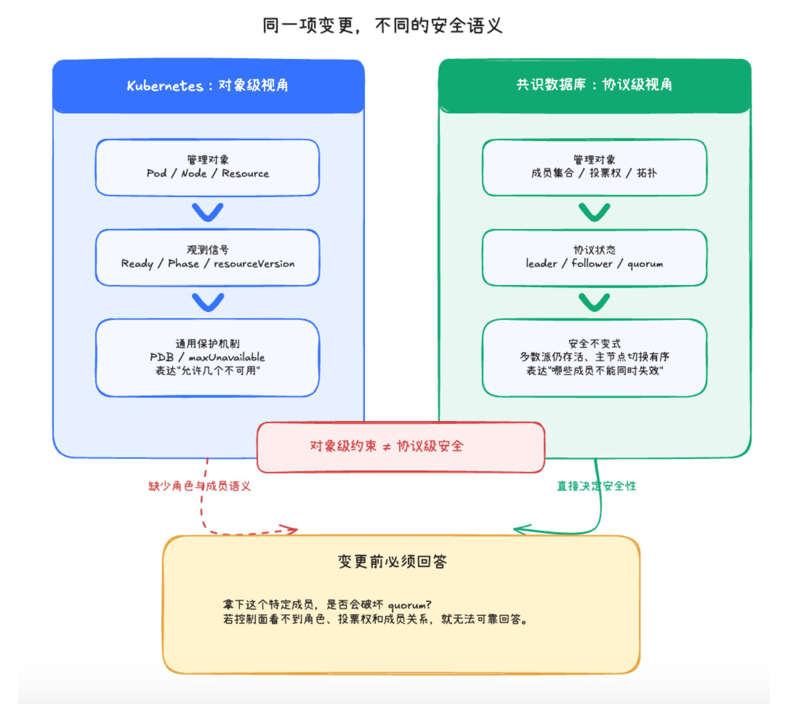
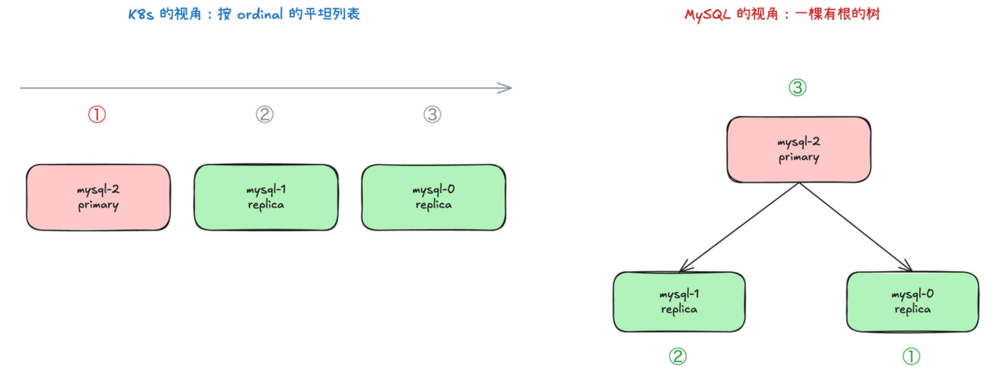
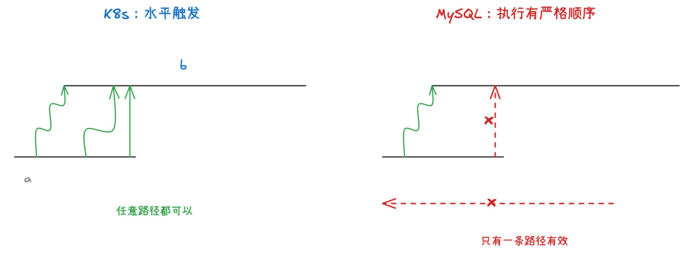
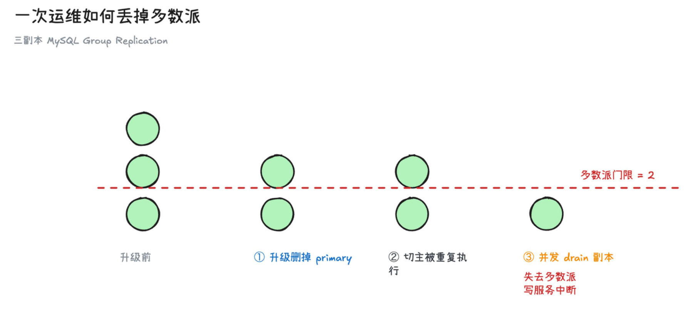
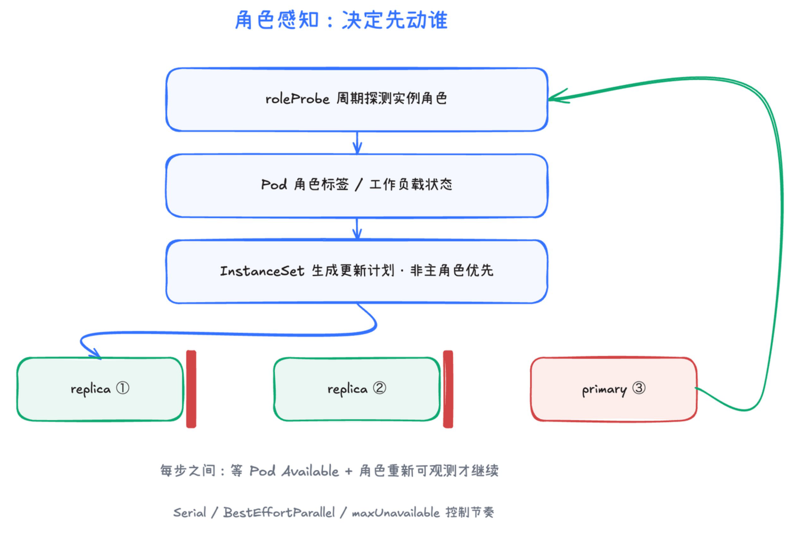
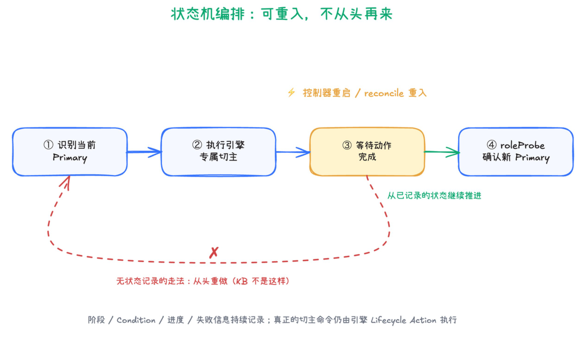
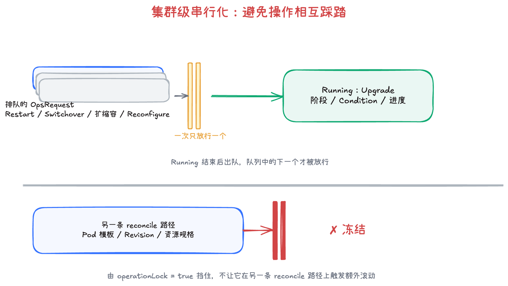
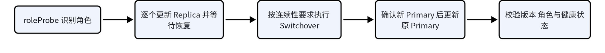

# Quorum 与角色感知的变更与中断

::: info 本文关注的问题
当数据库集群的可用性依赖 quorum，而 Kubernetes 主要以 Pod 和资源对象为管理粒度时，滚动升级、节点排空、缩容、驱逐和重启等操作，如何避免破坏共识协议的安全边界？本文以 KubeBlocks 为例，梳理其中的语义冲突、可行解法，以及当前仍待补齐的能力。
:::

---

## 1. 问题定义

对于基于共识协议（如 Raft、Paxos）的数据库，系统可用性依赖多数派（quorum）。在典型的 `2f + 1` 副本配置下，系统通常可以容忍 `f` 个故障。因此，滚动升级、节点排空（`drain`）、缩容、驱逐和重启等变更，都必须同时满足以下约束：

1. **安全性（safety）约束**：任何时刻，存活的投票成员数都不能低于 quorum。
2. **角色变更顺序约束**：移除或重启当前主节点（leader/primary）之前，必须先完成 `switchover`，并确认新的主节点已经稳定接管；否则可能触发非计划故障转移，极端情况下甚至导致脑裂。

原生 Kubernetes 主要围绕 Pod、节点和资源对象进行调度与收敛，并不原生感知数据库的角色、成员关系和 quorum。因此，单靠 Kubernetes 的通用调度与驱逐机制，无法完整表达上述约束。

*图 1｜Kubernetes 与共识数据库的管理粒度*

图中最关键的差异是：Kubernetes 主要处理对象级状态，而共识数据库需要维护成员集合级、协议级的安全约束。

## 2. 矛盾点

::: tip 一句话概括
Kubernetes 主要管理单个资源对象，而数据库集群维护的是角色关系、成员集合与协议不变式。两者在可用性粒度、执行模型和并发语义上并不对齐。
:::

| 错位 | Kubernetes 的视角 | 数据库的视角 | 直接风险 |
| --- | --- | --- | --- |
| <strong>① 可用性粒度错位</strong> | Pod 是否 `Ready`；一次允许中断几个 Pod | 被中断的是 primary 还是 replica；投票成员是否存活；quorum 是否仍然成立 | 数量上只中断一个 Pod，角色上却可能恰好关掉主库或关键投票成员 |
| <strong>② 执行模型错位</strong> | reconciliation 循环；最终一致、失败重试；没有全局事务 | 操作严格有序；成员变更串行化；部分协议需要 joint consensus | 多个可重试步骤发生交错，可能破坏协议要求的操作顺序 |
| <strong>③ 并发语义错位</strong> | `resourceVersion`；冲突后重新读取并重试 | 协议级互斥；幂等或防重复执行；同一时刻只有一个变更生效 | 对象更新没有冲突，不代表数据库操作之间不存在竞争 |

### 具体场景：一次日常运维如何依次触发三种错位

**场景设定**：一个三副本 MySQL Group Replication 集群，副本为 `mysql-0`、`mysql-1`、`mysql-2`。它刚经历过一次故障转移，primary（主库）已从 `mysql-0` 切换到 `mysql-2`。数据库角色会变化，但 StatefulSet 的 ordinal 不会随之变化。

| Pod | 当前数据库角色 | StatefulSet 默认更新顺序 |
| --- | --- | --- |
| `mysql-2` | primary | 第 1 个 |
| `mysql-1` | replica | 第 2 个 |
| `mysql-0` | replica | 第 3 个 |

**① 可用性粒度错位：升级先选中了 primary。**

StatefulSet 的默认滚动升级按 ordinal 从大到小进行，于是先删除 `mysql-2`，重建并等待 `Ready`，再处理下一个 Pod。对 Kubernetes 而言，这只是"一次只动一个 Pod"的标准操作；但对 MySQL 而言，被删掉的正是当前主库。

→ **操作对象选错了**：Kubernetes 的粒度是 Pod，数据库的粒度是"角色 + 投票成员"。

*图 2｜同一个集群，两套不同的拓扑：K8s 按 ordinal 排成平表，MySQL 是一棵有根的角色树*

::: warning 为什么 PDB maxUnavailable: 1 仍然不够？
它最多表达"一次不要中断太多 Pod"，却不能表达"不要先中断 primary"。对于 `drain` 等自愿驱逐，PDB 可以限制中断数量；对于 StatefulSet 自身的滚动更新，更新顺序由 StatefulSet 策略决定。无论哪种情况，**一次只停一个 Pod，也不等于这一次中断是安全的**。
:::

**② 执行模型错位：切主完成后控制器重启，动作被重复执行。**

正确流程本应先 `switchover`、确认新 primary 已稳定接管，再处理旧主。假设控制器已经完成切主，但随后重启（或 reconcile 重入、步骤重试），此前的步骤被再次执行：重复的 `switchover`、重复的 Pod 删除，或在新 primary 尚未稳定时又触发新的变更。

→ **操作顺序或重试方式错了**：协议要求成员变更严格有序、串行化，而 reconciliation 模型是"最终一致、失败重试、无全局事务"。

*图 3｜两种执行模型：K8s 是水平触发、任意路径可达；协议要求唯一有效的执行顺序*

**③ 并发语义错位：节点维护正在同时驱逐 `mysql-1`。**

就在升级推进时，节点维护正在对 `mysql-1` 执行 `drain`。滚动升级与节点排空都是各自"正确"的操作，却由不同控制器独立发起，彼此并不知道对方也在动同一个集群。

→ **多个单独正确的操作组合在一起错了**：对象级并发（`resourceVersion`）不冲突，不代表协议级操作之间不存在竞争。

**→ 结果：只剩 `mysql-0`，集群失去多数派。**

此刻 `mysql-2`（原 primary）正在重建、`mysql-1` 被驱逐，只有 `mysql-0` 仍在运行。三副本 Group Replication 的多数派门限是 2，存活投票成员却只剩 1 个（1 < 2）：集群失去多数派，无法继续提供写服务，也无法自动选出新主，只能等待成员恢复。**每个动作单独看都"只影响一个 Pod"，叠加起来却击穿了 quorum。**

*图 4｜三个动作依次叠加：存活投票成员从 3 降到 1，跌破多数派门限 2*

::: tip 三个矛盾点，一句话概括
- **① 可用性粒度错位**：操作对象选错了。
- **② 执行模型错位**：操作顺序或重试方式错了。
- **③ 并发语义错位**：多个单独正确的操作组合在一起错了。
:::

::: info 适用范围
传统 MySQL Primary-Replica 架构主要关注角色与复制状态；MySQL Group Replication、InnoDB Cluster，以及采用 Raft、Paxos 的数据库，还必须进一步满足成员关系与 quorum 约束。两类条件经常同时出现，但不能混为一谈。
:::

### 同一个升级动作，两套不同的完成标准

| Kubernetes 控制器判断"可以更新下一个 Pod" | MySQL 判断"当前成员已经恢复，可以继续变更" |
| --- | --- |
| 1. 目标 Revision 的新 Pod 已创建 2. Pod 已进入 `Running` 3. readiness probe 已通过 4. 满足更新策略，可以继续处理下一个 Pod | 1. 实例已重新加入复制组 2. 复制或日志状态达到数据库引擎定义的健康条件 3. 集群仍具备预期的写入能力；共识系统还需满足 quorum 4. 当前变更不会与切主、退组等协议操作发生冲突 |

**角色感知的安全升级分为两个阶段：**

| 阶段一：更新 Replica | 阶段二：更新 Primary |
| --- | --- |
| `识别角色` → `更新一个 Replica` → `等待重新加入并恢复健康` → `更新下一个 Replica` | `选择切主目标` → `执行 Switchover` → `确认新 Primary` → `更新原 Primary` |

### 其他常见场景

| Kubernetes 操作 | 控制器看到的完成条件 | 数据库还需要确认什么 |
| --- | --- | --- |
| 节点 `drain` | 满足 PDB 等驱逐条件即可迁走 Pod | 实例的角色、投票权和剩余成员状态；此次中断不能破坏写入能力或 quorum。 |
| StatefulSet 缩容 | 优先删除 ordinal 最大的 Pod | 目标实例是否已完成安全退组；删除后成员配置和 quorum 是否仍然有效。 |
| 直接删除或重启 Pod | Pod 会被工作负载控制器重新创建 | 是否正在发生故障转移；重建实例能否按预期重新加入并恢复角色。 |
| 升级、VPA、Descheduler、运维脚本并发 | 各控制器分别完成自身的 reconciliation | 是否与同一集群的升级、切主或成员变更冲突；叠加后是否同时影响多个成员。 |

> **Kubernetes 原生行为参考**：[StatefulSet 滚动更新](https://kubernetes.io/docs/concepts/workloads/controllers/statefulset/#rolling-updates)、[PodDisruptionBudget](https://kubernetes.io/docs/tasks/run-application/configure-pdb/)、[安全执行节点 drain](https://kubernetes.io/docs/tasks/administer-cluster/safely-drain-node/)。

::: warning 本节结论
- Pod `Ready` ≠ 数据库成员已恢复健康
- Kubernetes 重试安全 ≠ 数据库协议动作可以重复执行
- 对象更新没有冲突 ≠ 数据库运维操作可以并发
- 存活 Pod 数量满足预算 ≠ 数据库 quorum 一定成立
:::

## 3. 从语义错位到分层解法

::: tip 解法的核心不是增加一个参数，而是形成闭环
先让控制面看见数据库角色和成员状态，再在变更入口做安全判断，通过状态机按顺序执行，最终由数据库协议保证数据与成员关系的正确性。
:::

### 四层运行时机制

| 层级 | 核心能力 | 解决的问题 | 主要边界 |
| --- | --- | --- | --- |
| **1. 观测层** | 暴露角色、投票权、成员关系、复制或日志状态，以及当前不可用成员数 | 让控制面能够判断"正在操作谁"和"操作后还剩下谁" | 状态可能存在延迟；不能只依赖 Pod `Ready` |
| **2. 准入层** | 在计划变更或自愿驱逐生效前，检查角色、健康状态和 quorum | 阻止一次明显不安全的升级、缩容或驱逐 | 无法阻止节点硬故障；还依赖观测数据的准确性 |
| **3. 编排层** | 将 `switchover → 角色确认 → 有序更新 → 最终校验` 建模为可恢复状态机 | 保证步骤顺序、操作互斥，以及控制器重启后的续跑 | 每个数据库动作仍需具备幂等性和明确的失败恢复语义 |
| **4. 协议层** | 通过数据库自身的选举、复制和成员变更协议维护 safety | 在故障和重试发生时，保证不会产生错误提交或非法成员配置 | 必须遵循具体引擎语义，不能仅靠通用 Kubernetes 原语实现 |

::: info 关于 joint consensus
它主要用于改变投票成员集合，例如扩容、缩容和成员替换；普通进程重启或镜像升级不一定涉及 joint consensus，但仍需保证剩余成员满足 quorum，并控制 Leader / Primary 的处理顺序。
:::

## 4. KubeBlocks 的处理机制与能力边界

::: tip KubeBlocks 的处理思路是把数据库语义逐层引入控制面
`roleProbe` 负责观测角色，`InstanceSet` 负责生成角色感知的更新计划，`OpsRequest` 负责状态化执行，集群级队列负责避免多个计划内运维操作同时推进。
:::

| 矛盾点 | KubeBlocks 的机制 | 解决的问题 | 能力边界 |
| --- | --- | --- | --- |
| <strong>可用性粒度错位</strong> | `roleProbe`、Pod 角色标签、角色感知更新顺序、`maxUnavailable` | 不再只按 Pod 名称或 ordinal 更新，而是优先处理 replica / follower，最后处理 primary / leader | 主要覆盖 KubeBlocks 管控内的计划变更；外部驱逐不一定经过该计划 |
| <strong>执行模型错位</strong> | `OpsRequest` + `switchover`、`memberJoin`、`memberLeave` 等 Lifecycle Action | 将数据库动作拆成可观测、可等待、可恢复的步骤 | 动作的幂等性与失败恢复仍依赖具体数据库引擎实现 |
| <strong>并发语义错位</strong> | `QueueByCluster` + `operationLock` | 将同一 Cluster 的高风险运维串行化，避免额外模板变更干扰正在执行的操作 | 无法统一约束 VPA、Descheduler、节点维护、手工操作和其他 Operator |

### 角色感知：决定先动谁

`roleProbe` 周期性识别实例当前是 primary、replica、leader、follower 还是 learner，并将角色写入 Pod 标签和工作负载状态。`InstanceSet` 据此生成更新计划，优先处理非主角色，并通过 `Serial`、`BestEffortParallel` 和 `maxUnavailable` 控制更新节奏。每更新一个实例，都需要等待 Pod 恢复为 Available、角色重新可观测后，再继续推进。

*图 5｜roleProbe 观测角色，InstanceSet 据此生成"非主角色优先"的更新计划*

### 状态机编排：决定按什么顺序执行

`OpsRequest` 将 Upgrade、Restart、Switchover、扩缩容和 Reconfigure 等操作建模为有状态流程，持续记录执行阶段、Condition、进度和失败信息。控制器重启或 reconcile 重入后，可以根据已有状态继续协调。

以 `Switchover` 为例，处理链路是：

`识别当前 Primary` → `执行引擎专属切主动作` → `等待动作完成` → `roleProbe 确认新 Primary` → `操作成功`

真正的切主、加成员和删成员命令仍由数据库引擎的 Lifecycle Action 实现，KubeBlocks 负责流程编排与状态确认。

*图 6｜OpsRequest 的状态机编排：可重入，控制器重启后从已记录状态继续推进，而不是从头重做*

### 集群级串行化：避免操作相互踩踏

Upgrade、Restart、Switchover、扩缩容和 Reconfigure 等操作通常启用 `QueueByCluster`。当一个操作处于 Running 状态时，后续操作先进入队列；`operationLock` 则用于避免普通 Pod 模板、Revision 或资源规格变更在另一条 reconcile 路径上触发额外滚动。

*图 7｜集群级串行化：OpsRequest 排队、一次只放行一个，operationLock 冻结另一条 reconcile 路径*

### MySQL 示例：计划内升级的四个阶段

*图 8｜MySQL 计划内升级的四个阶段：识别角色 → 逐个更新 Replica → 执行 Switchover → 更新原 Primary 并校验*

::: warning Primary 最后更新，不等于自动完成计划内切主
普通 Upgrade 可以做到 replica 优先、primary 最后；如果业务要求连续写入，应在处理原 primary 前显式编排 `Switchover`，并等待 `roleProbe` 确认新的 primary 已稳定接管。
:::

### 仍待补齐的能力

| 方向 | 当前缺口 | 建议补齐的能力 |
| --- | --- | --- |
| **中断准入** | 节点 `drain`、抢占、手工删除等外部中断不一定经过 `InstanceSet` 更新计划 | 将角色、投票权、健康状态和 quorum 接入驱逐准入，在中断发生前判断是否安全 |
| **协议动作** | Lifecycle Action 提供执行入口，但切主、退组和成员变更的幂等性、回滚与恢复仍依赖引擎适配 | 建立统一的动作结果校验、断点续跑和失败恢复语义；成员集合变化遵循具体数据库协议 |
| **跨控制器协调** | `QueueByCluster` 只管理进入 `OpsRequest` 的运维操作，外部控制器不参加该队列 | 引入集群维护窗口、租约或协议语义锁，使基础设施变更能够感知正在进行的数据库操作 |

::: info 能力边界
KubeBlocks 已经能够较好地处理自身管控内的计划变更，但还不能单独保证所有外部中断都满足 quorum，也不存在跨 Kubernetes 与数据库协议的全局事务。数据库内核负责协议安全，控制面仍需负责变更准入、步骤编排和跨操作协调。
:::

## 5. 小结

问题的本质不是 Kubernetes 缺少某一个参数，而是 Pod 级控制模型无法直接表达数据库的角色关系、成员集合和协议不变式。安全变更需要形成"观测 → 准入 → 编排 → 协议保证"的闭环。

KubeBlocks 已经通过 `roleProbe`、`InstanceSet`、Lifecycle Action、`OpsRequest` 和集群级队列，将一部分数据库语义引入 Kubernetes 控制面。下一步的重点不是让 StatefulSet 理解更多数据库细节，而是补齐 quorum-aware 的中断准入、跨控制器协调，以及协议动作的幂等与失败恢复，使计划内运维和基础设施中断共享同一套安全边界。
